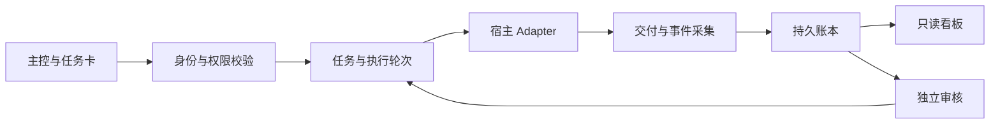

# Conductor｜多 Agent 开发协作控制面

Conductor 将项目、任务、执行成员、交付与审核汇总到一个控制面，让主控能够指定成员执行任务，并追踪每一轮实现、返工和独立审核。项目原代号为 D4，代码中的 `d4_*`、schema 和历史实验名称仍可见。

> **首次源码展示快照，非稳定发行版。** 本仓库未完成独立安装和端到端验收，不承诺 clone 后可以直接运行。此快照不包含作者的实际项目数据、账号配置、运行日志或历史任务证据。

## 项目关注的问题

- 多个项目、Agent 与宿主的开发进度分散。
- 已提交、宿主已接收、已执行、已交付和已审核容易混淆。
- 返工覆盖旧结果，角色与证据缺少关联。
- 看板需要可读摘要，同时保留技术追溯能力。

## 代码结构

| 目录 | 职责 |
|---|---|
| `contracts/` | 任务、成员、文档与事件合同及校验 |
| `service/` | 任务、事件、审核、来源导入和成员服务 |
| `storage/` | SQLite 存储与迁移逻辑 |
| `adapters/` | 宿主协议适配与任务权限检查 |
| `projections/` | 看板读模型及有界只读来源投影 |
| `board/` | 浏览器看板界面 |
| `scripts/` | CLI、采集器、看板和本机入口工具 |
| `tests/` | 测试源码与合成SQL fixture；部分测试仍依赖未公开环境 |
| `orchestrator/` | 保留的早期实验与运输层依赖，不是稳定调度承诺 |

## 协作模型

`task` 表示目标，`attempt` 表示一次执行，`delivery` 表示交付版本，`review` 表示对指定交付的决定。开发自报、QA、主控审核和发布分别记录。未知执行结果先对账，不通过重跑原任务补回执。

## 当前边界

本仓库以工程展示为目标，保留开发中的实现和测试，不宣称全部宿主已接通。完整 MVP、真实宿主隔离、自动通知、用户级安装和跨项目独立验收仍应按具体环境验证。历史测试成绩未作为此导出副本的通过声明。

公开副本对个人路径、内部工程标记、任务和会话编号做了示例化替换；这些变更可能使原有冻结SHA测试或本机绑定检查失败。真实 Adapter 需要操作者自己配置受控运行环境，不能直接复用作者配置。

- [架构与角色](docs/architecture.md)
- [状态与限制](docs/status.md)
- [导出范围与隐私处理](docs/public-snapshot.md)
- [工程经验](docs/lessons.md)
- [验证说明](docs/verification.md)

## 许可证

当前未授予开源使用许可证；公开可见不等于获得任意使用、修改或再分发授权。后续确定许可后再加入正式 LICENSE。第三方宿主、SDK 和 CLI 不随仓库分发。
