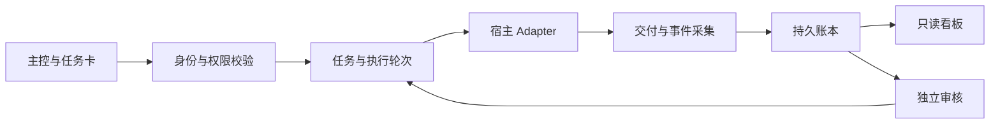

# Conductor｜多 Agent 开发协作控制面

Conductor 将项目、任务、执行成员、交付与审核汇总到一个控制面，让主控能够指定成员执行任务，并追踪每一轮实现、返工和独立审核。项目原代号为 D4，代码中的 `d4_*`、schema 和历史实验名称仍可见。

> **首次源码展示快照，非稳定发行版。** 本仓库未完成独立安装和端到端验收，不承诺 clone 后可以直接运行。此快照不包含作者的实际项目数据、账号配置、运行日志或历史任务证据。

## 项目关注的问题

- 多个项目、Agent 与宿主的开发进度分散。
- 已提交、宿主已接收、已执行、已交付和已审核容易混淆。
- 返工覆盖旧结果，角色与证据缺少关联。
- 看板需要可读摘要，同时保留技术追溯能力。

## 它想解决什么

Conductor（原 D4）想让不同项目、不同平台里的 AI 开发成员能在一个地方分工合作，进度和结果也能查得到。

1. **把不同平台的 AI 成员放进同一套协作流程。**例如 WorkBuddy、CodeBuddy、QClaw、DSH 等平台里的 Agent，可以按任务分工：主控负责拆任务、定边界和检查结果，具体工作交给执行 Agent。这样有望减少主控承担的执行细节、缓解上下文和 token 压力；实际能省多少，还要按任务和平台测量。
2. **把项目和任务进度放在一起看。**记录任务做到哪一步、谁在做、交了什么、是否需要返工，减少多个项目并行时信息散落各处。自动更新取决于对应平台是否接通任务回传。
3. **让成员分工更清楚，也更容易配置。**按开发、测试等职责登记 Agent，并用角色模板说明它负责什么、任务边界和汇报要求。模板帮助配置角色和任务规范；实际权限控制仍取决于宿主和运行环境的隔离能力。

目前项目仍在开发中，只有部分宿主和链路经过验证，不能认为上述平台都已接通或配置后就能稳定运行。完整 MVP 尚未完成独立验收。

## 代码结构

| 目录 | 职责 |
|---|---|
| `contracts/` | 任务、成员、文档与事件合同及校验 |
| `service/` | 任务、事件、审核、来源导入和成员服务 |
| `storage/` | SQLite 存储与迁移逻辑 |
| `adapters/` | 宿主协议适配与任务权限检查 |
| `projections/` | 看板读模型及有界只读来源投影 |
| `board/` | 浏览器看板界面 |
| `scripts/` | CLI、采集器、看板和本机入口工具 |
| `tests/` | 测试源码与合成SQL fixture；部分测试仍依赖未公开环境 |
| `orchestrator/` | 保留的早期实验与运输层依赖，不是稳定调度承诺 |

## 协作模型

`task` 表示目标，`attempt` 表示一次执行，`delivery` 表示交付版本，`review` 表示对指定交付的决定。开发自报、QA、主控审核和发布分别记录。未知执行结果先对账，不通过重跑原任务补回执。

## 案例研究

每个案例按「问题 → 关键动作 → 结果与证据 → 取舍 → 追问准备」组织，整理自开发记录：

1. [从重复传话到可追溯交付](docs/case-studies/01-traceable-delivery.md) —— task / attempt 建模与真实双轮验证
2. [超时后先恢复事实再决定重试](docs/case-studies/02-recovery-before-retry.md) —— unknown 状态与恢复对账
3. [看板刷新正确性与交互连续性](docs/case-studies/03-dashboard-consistency.md) —— 只读投影与 UI 稳定性
4. [离线通过后仍拒绝宣布接入](docs/case-studies/04-entry-gate.md) —— 入口门与证据分级
5. [从页面原型到本机交付](docs/case-studies/05-page-to-delivery.md) —— 启动时序与安装恢复

## 当前边界

本仓库以工程展示为目标，保留开发中的实现和测试，不宣称全部宿主已接通。完整 MVP、真实宿主隔离、自动通知、用户级安装和跨项目独立验收仍应按具体环境验证。历史测试成绩未作为此导出副本的通过声明。

公开副本对个人路径、内部工程标记、任务和会话编号做了示例化替换；这些变更可能使原有冻结SHA测试或本机绑定检查失败。真实 Adapter 需要操作者自己配置受控运行环境，不能直接复用作者配置。

### 数字的使用范围

以下计数各自保留单位与限定范围，不相加、不外推：

| 内容 | 可支持的表述 | 不扩大的含义 |
|---|---|---|
| 离线链路 636 tests / 70 probes | 阶段限定的离线验证 | 不证明真实入口、模型与生产环境通过 |
| 看板 54 项回归 | 单轮 UI 修复范围（来源、路径、角色、刷新） | 非全项目通过、非覆盖率指标 |
| App 安装 516 项测试 | 历史安装与指定运行场景验证 | 不与其他计数相加为全项目验证 |
| 7 项目 / 29 工作条目导入 | 导入时点的资料组织范围 | 非「29 个已验收交付」 |
| 回执导入 | 人工核验后导入 | 未包装为全自动调度 |

完整表述分级（历史真实验证 / 实现可定位 / 正式设计与规则 / 待核或未运行）见[表述边界与证据分级](docs/claims-and-boundaries.md)。

- [架构与角色](docs/architecture.md)
- [状态与限制](docs/status.md)
- [导出范围与隐私处理](docs/public-snapshot.md)
- [工程经验](docs/lessons.md)
- [验证说明](docs/verification.md)
- [表述边界与证据分级](docs/claims-and-boundaries.md)
- [案例研究](docs/case-studies/)

## 许可证

当前未授予开源使用许可证；公开可见不等于获得任意使用、修改或再分发授权。后续确定许可后再加入正式 LICENSE。第三方宿主、SDK 和 CLI 不随仓库分发。
